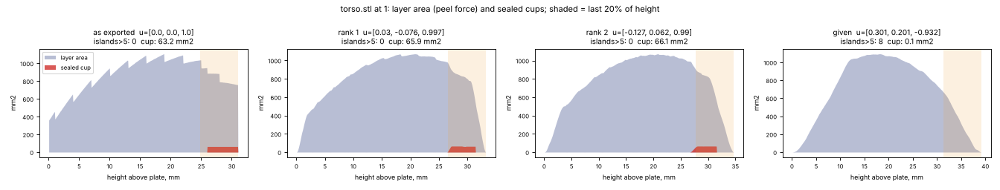
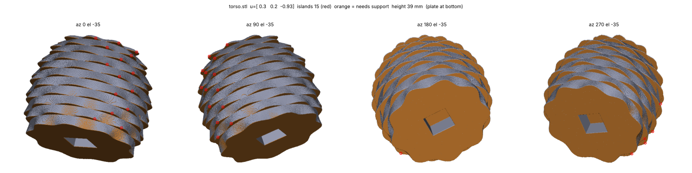
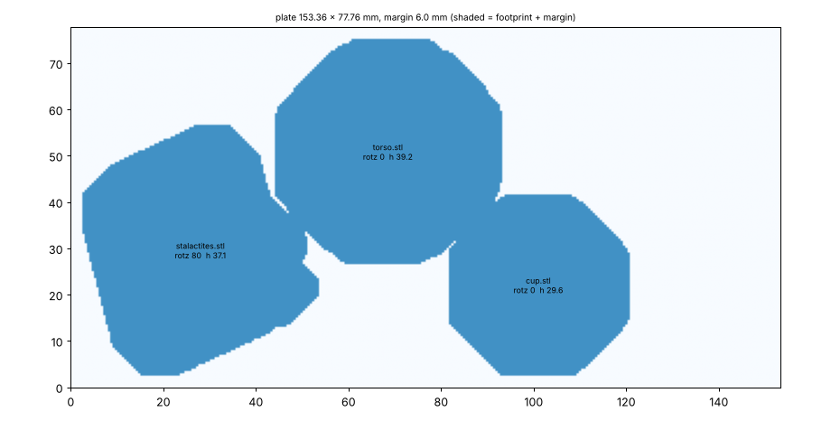

# resin-part-orientation

A Claude skill, and the command-line tool behind it, for orienting resin 3D-print parts before they go to the slicer.

You give it the STL files of a kit and a size. It gives back a build direction for each part, a plate layout, and STL files that are already scaled and tilted. You add the supports yourself in the slicer.

It looks for four things that ruin resin prints and that a slicer's auto-orient does not check together:

| Problem | What it looks like on the print | How the tool finds it |
|---|---|---|
| Islands | Ragged, flaky fringe on edges that point at the plate | Counts regions that start printing in mid-air and how long they float |
| Suction cups | One clean split at a set height, or a failed layer | Finds pockets that are sealed against the vat film while they print |
| Late peel spikes | Layers splitting into sheets near the end of a long print | Measures the area of every layer and where the largest ones fall |
| Supports on visible faces | Pitting on faces, fingers, textured armour | Shows where support is needed in each pose so you can put it on glue faces |



*`check` on a synthetic test torso with a key socket in its top face. The first three poses were the best by overhang score, and all three leave the socket as a sealed cup (red). The fourth pose turns the socket toward the plate: no cup, at the cost of a few islands to support.*

## What is in this repo

| File | What it is |
|---|---|
| `SKILL.md` | The skill: workflow, decision rules, lessons from real prints, and an embedded copy of the tool. Self-contained. |
| `resin_orient.py` | The same tool as a standalone script. A test keeps it identical to the copy in `SKILL.md`. |
| `docs/how-it-works.md` | How each analysis works, step by step, with its limits. |
| `tests/` | Synthetic parts with known answers, and the tests that run the tool against them. |

## Using it as a Claude skill

`SKILL.md` is all Claude needs. Add it to Claude as a custom skill, attach the STL files of the kit and call it with a size:

```
/resin-part-orientation M
```

| Size | Height of the assembled figure |
|---|---|
| S | 15 cm |
| M | 18 cm |
| L | 20 cm |

You can also give a height (`17cm`) or a scale (`60%`). Height means all parts together along the up axis, base and raised weapons included. Measuring it needs the whole kit with the parts in their assembled positions; if the files are laid flat for printing, Claude asks for the kit's height at 100% instead.

Claude then works through the steps below and sends back preview images, the check chart, the plate layout and a zip of oriented STLs, with instructions for importing them.

## Using the tool on its own

Requirements: Python 3 (tested on 3.13), `numpy`, `scipy`, `matplotlib`. `numba` is optional and makes `sweep` roughly ten times faster.

```bash
pip install -r requirements.txt
```

A full run on one part looks like this. All lengths are in mm, and `--scale` is applied before any analysis.

```bash
# 1. scale for a size, from the whole kit
python3 resin_orient.py size kit/*.stl

# 2. mesh health: size, volume, open edges, number of shells
python3 resin_orient.py info torso.stl --scale 0.62

# 3. look at the part as exported
python3 resin_orient.py show torso.stl --scale 0.62 --u=0,0,1 --out as_exported.png

# 4. score 300 build directions, then list the best
python3 resin_orient.py sweep torso.stl --scale 0.62 --out torso.npy
python3 resin_orient.py rank torso.npy

# 5. slice the finalists: islands, layer area, suction cups
python3 resin_orient.py check torso.stl --scale 0.62 --from torso.npy --out check.png --json check.json

# 6. see where supports would land in a candidate pose
python3 resin_orient.py show torso.stl --scale 0.62 --u=0.3,0.2,-0.93 \
    --views "0,-35;90,-35;180,-35;270,-35" --out pose.png

# 7. fit the parts on the plate (PART@direction@scale)
python3 resin_orient.py pack --margin 6 --out layout.json --png layout.png \
    torso.stl@0.3,0.2,-0.93@0.62 head.stl@0,0.5,-0.87@0.62

# 8. write the scaled, oriented STL, using rotz from layout.json
python3 resin_orient.py export torso.stl --scale 0.62 --u=0.3,0.2,-0.93 --rotz 80 --out torso_oriented.stl
```

`--u` is the build direction: the vector, in the part's own coordinates, that should point away from the build plate. `--u=0,0,1` is the part as exported. Write a direction that starts with a minus sign with an equals sign, as above.

Run the tool as `python3 -I resin_orient.py ...` when the model files come from someone else. `-I` stops Python from importing code that sits next to the files.



*`show` on the same test part. Orange needs support, red circles mark island starts. The plate is at the bottom of each view.*



*`pack` output. The shaded shapes are each part's footprint plus its margin.*

## How it works, in short

1. **Sweep.** For 300 directions spread evenly over the sphere, plus the as-exported pose, the tool walks the mesh surface from the plate upward and counts islands: places where printing starts with nothing underneath. It also measures the down-facing area and how much support that area would need. Each direction gets a score.
2. **Check.** The best directions are then sliced for real: the solid is rasterised layer by layer at 0.3 mm by one layer height. This catches what the surface walk cannot: islands on overlapping shells, the area of every layer, and pockets that are sealed against the vat film.
3. **Choose.** Sealed cups are rejected first, then poses whose largest layers come at the end, then poses that put supports on visible detail. The numbers narrow the choice; the preview images decide it.
4. **Pack and export.** Footprints are packed on the plate with a margin for supports, and each part is written out scaled, rotated and sitting at z = 0.

[docs/how-it-works.md](docs/how-it-works.md) explains each step in detail.

## Printer and resin defaults

The skill was written for one setup: an Elegoo Mars 5 Ultra (plate 153.36 x 77.76 mm, 165 mm build height, 0.05 mm layers), the Elegoo SatelLite slicer and Elegoo ABS-Like 3.0 resin, printing in a cold garage. The "Lessons" sections of `SKILL.md` come from prints on that setup.

For another printer:

| What | Where |
|---|---|
| Plate size | `pack --plate WIDTHxDEPTH` |
| Build height | `Z_MAX` near the top of `resin_orient.py` |
| Layer height | `--layer` on `sweep`, `check` and `show` |
| Support lift | `--lift` on `sweep` and `pack` |
| Sizes | `SIZES` in `resin_orient.py` and the table in `SKILL.md` |
| Printer, slicer and resin notes | the "Default printer" paragraph and the Lessons in `SKILL.md` |

If you change the tool, change it in `SKILL.md` and re-extract `resin_orient.py` with the command in step 1 of the skill. The first test fails if the two differ.

## Limits

- It does not generate supports and it is not a slicer. It chooses the pose; the slicer's island and cavity checks still need to be run on the result.
- The sweep reads the surface only. On a part made of several overlapping shells it misses islands, which is why the finalists are always sliced with `check`.
- `check` slices at 0.3 mm pixels. A feature thinner than that, such as a 0.2 mm strap, can vanish, and whatever it carries then counts as an island. Use `--px 0.15` on thin parts.
- Open edges (holes in the mesh) make the slices unreliable. `info` reports them.
- `pack` keeps `--margin` around each part, so parts end up about 1.5 to 2 times the margin apart.
- The S/M/L scale is only as good as the height it is measured from. Parts that are not in their assembled positions need the height given by hand.
- 3MF support covers the mesh layout that SatelLite writes. Other 3MF files may not load.

## Tests

```bash
pip install -r requirements.txt -r tests/requirements.txt
python3 tests/run_tests.py
```

The tests build small parts whose answers are known from their geometry, for example a cylinder with a 7 mm radius pocket, which must be reported as a 154 mm² cup when the pocket faces the film and as no cup when it faces the plate. They take about a minute. The parts are synthetic; the tests do not cover real sculpts.
